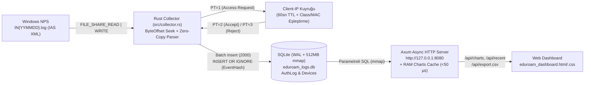

# Sistem Mimarisi ve Operasyon Kılavuzu (`ARCHITECTURE.md`)

**Eduroam NPS Loglama Sistemi (v5.2 — Rust Edition)** — Kastamonu Üniversitesi Bilgi İşlem Daire Başkanlığı

---

## 1. Mimari Genel Bakış

Sistem v5.2 itibarıyla tek bir bağımsız çalıştırılabilir dosya (`eduroam-nps.exe`) içinde çalışan **Rust motoru** üzerine kuruludur:

1. **Veri Toplama Katmanı (`src/collector.rs` + `src/parser.rs`):** Windows NPS'in ürettiği günlük IAS XML loglarını (`IN{YYMMDD}.log`) `FILE_SHARE_READ | FILE_SHARE_WRITE` bayraklarıyla açar, `last_run.txt` içindeki `ByteOffset` konumuna doğrudan atlar (`SeekFrom::Start`), sıfır-kopya (zero-copy) ayrıştırıcı ile satırları okur ve 2.000'lik batch transaction'larla SQLite'a yazar.
2. **Veri Saklama Katmanı (`src/db.rs` — `eduroam_logs.db`):** WAL (Write-Ahead Logging) ve **512 MB Memory-Mapped I/O (`mmap`)** modunda çalışan gömülü (bundled) SQLite veritabanı.
3. **Sunum ve API Katmanı (`src/server.rs` + `eduroam_dashboard.html`):** `tokio` + `axum` tabanlı asenkron HTTP sunucusu ve atomik nesil (`db_generation`) kontrollü bellek içi `/api/charts` önbelleği.



---

## 2. RADIUS Paket Eşleştirme (TTL + Class/MAC Öncelikli Kuyruk)

Windows NPS IAS loglarında `PT=2` (Access-Accept) satırlarında kullanıcı adı (`User-Name`) genellikle yer almaz; bu bilgi `PT=1` (Access-Request) paketindedir. Rust motoru (`match_pending_request` — `src/collector.rs`) veri kaymasını (cross-contamination) önlemek için 4 aşamalı bir algoritma uygular:

1. **TTL Temizliği (60 Saniye):** Kuyruğun başındaki `PT=1` paketlerinin yaşı `pendingTtlSeconds` (varsayılan `60` sn) değerini aşmışsa (zaman aşımına uğramış EAP oturumu), kuyruktan düşürülür.
2. **Öncelik 1 — `Class` Özniteliği Eşleşmesi:** Hem `PT=1` hem `PT=2/3` paketinde RADIUS `Class` özniteliği varsa birebir eşleşen kayıt çekilir.
3. **Öncelik 2 — `Calling-Station-Id` (MAC) Eşleşmesi:** İstemci MAC adresi her iki pakette de mevcutsa büyük/küçük harf duyarsız olarak aynı MAC adresine ait `PT=1` kaydı çekilir.
4. **Öncelik 3 — FIFO Fallback:** Aynı `Client-IP` kuyruğundaki en eski canlı (TTL süresi dolmamış) `PT=1` kaydı çekilir.
5. **Gece Yarısı Dosya Geçişi Koruması:** `pt1_cache` dosya döngüsü dışında yaşadığı için `23:59:59` (`IN260608.log`) ile `00:00:00` (`IN260609.log`) arasındaki oturumlar kesintisiz eşleşir.

---

## 3. Veritabanı Şeması ve Tekillik (`EventHash`)

### 3.1 `AuthLog` Tablosu

| Sütun | Tip | Açıklama |
|---|---|---|
| `LogID` | `INTEGER PRIMARY KEY AUTOINCREMENT` | Otomatik artan birincil anahtar |
| `EventID` | `INTEGER` | RADIUS Packet-Type (`2` = Accept, `3` = Reject) |
| `TimeCreated` | `TEXT` | `yyyy-MM-dd HH:mm:ss` formatında olay zamanı |
| `FullUsername` | `TEXT` | Ham kullanıcı kimliği (`kullanici@kurum.edu.tr`) |
| `Username` | `TEXT` | `@` öncesi kullanıcı adı |
| `Realm` | `TEXT` | `@` sonrası kurum etki alanı (`kastamonu.edu.tr` vb.) |
| `ClientIP` | `TEXT` | İsteği gönderen AP / kontrolcü IP adresi |
| `NASIdentifier` | `TEXT` | AP / NAS tanımlayıcı adı |
| `NASIPAddress` | `TEXT` | NAS IP adresi |
| `CalledStationID` | `TEXT` | AP MAC / SSID bilgisi |
| `CallingStationID` | `TEXT` | İstemci cihaz MAC adresi |
| `AuthType` | `TEXT` | Kimlik doğrulama sağlayıcısı (`Provider-Name`) |
| `PolicyName` | `TEXT` | Eşleşen NPS ağ ilkesi (`Proxy-Policy-Name`) |
| `ReasonCode` | `INTEGER` | NPS/RADIUS hata kodu (`0` = Başarılı) |
| `Reason` | `TEXT` | `ReasonCode` Türkçe karşılığı |
| `Result` | `TEXT` | `SUCCESS` veya `FAILURE` |
| `SourceFile` | `TEXT` | Kaynak log dosyası (`IN260608.log`) |
| `SourceLine` | `INTEGER` | Log dosyasındaki satır numarası |
| `EventHash` | `TEXT` | `SHA-256(SourceFile + "\n" + SourceLine + "\n" + RawLine)` |

### 3.2 `Devices` Tablosu ve Kronolojik Upsert Koruması

`Devices` tablosu her MAC adresinin ilk ve son görülme zamanını tutar. Geçmişe dönük backfill işlemlerinde son görülme bilgisinin eski kayıtlarla ezilmemesi için `UPSERT` sorgusu koşullu çalışır:
- `FirstSeen = MIN(Devices.FirstSeen, excluded.FirstSeen)`
- `LastSeen`, `LastUsername`, `LastResult` yalnızca `excluded.LastSeen >= Devices.LastSeen` olduğunda güncellenir.

---

## 4. HTTP API Sözleşmesi (`127.0.0.1:8080`)

| Endpoint | Yöntem | İçerik Tipi | Açıklama |
|---|---|---|---|
| `/` | `GET` | `text/html; charset=utf-8` | `eduroam_dashboard.html` (diskte varsa diskten, yoksa `.exe` içindeki gömülü kopyadan) |
| `/style.css` | `GET` | `text/css; charset=utf-8` | `eduroam_dashboard.css` (`Cache-Control: max-age=300`) |
| `/api/charts` | `GET` | `application/json; charset=utf-8` | Son `daysBack` günün özet metrikleri, trend, saatlik dağılım, AP/Realm/Reason istatistikleri (RAM önbellekli) |
| `/api/recent` | `GET` | `application/json; charset=utf-8` | Sayfalı ve filtreli log kayıtları (`page`, `limit`, `total`, `pages`, `capabilities`, `data`) |
| `/api/export.csv` | `GET` | `text/csv; charset=utf-8` | `/api/recent` ile aynı filtrelerle formül enjeksiyonu korumalı CSV çıktısı |

---

## 5. CLI Komutları (`eduroam-nps.exe`)

```powershell
# Varsayılan mod: HTTP Sunucusu + Arka Plan Otomatik Log Toplayıcı (her 30 sn)
eduroam-nps.exe serve

# Sadece HTTP Sunucusu (arka plan toplayıcı olmadan)
eduroam-nps.exe server

# Tek seferlik log toplama (Windows Task Scheduler uyumlu)
eduroam-nps.exe collect

# Veritabanı kurulumu veya mevcut DB üzerinde şema migration
eduroam-nps.exe setup --migrate

# Mevcut DB'yi silmeden son 90 günü yeniden tarama (Append-Only Backfill)
eduroam-nps.exe backfill --days 90

# Veritabanını sıfırlayıp son 7 günü baştan doldurma
eduroam-nps.exe reset-backfill --days 7 --force

# Windows başlangıcında otomatik çalışacak görevi kaydetme (Yönetici olarak)
eduroam-nps.exe register-tasks
```
